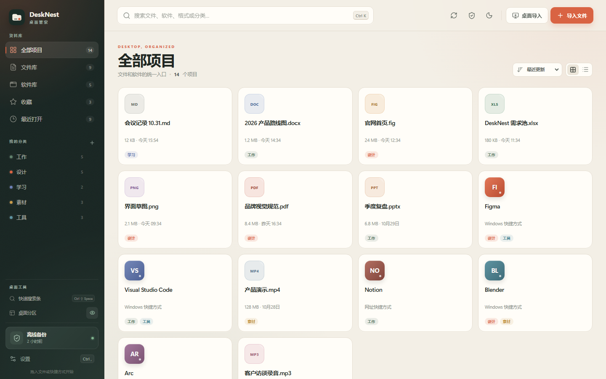
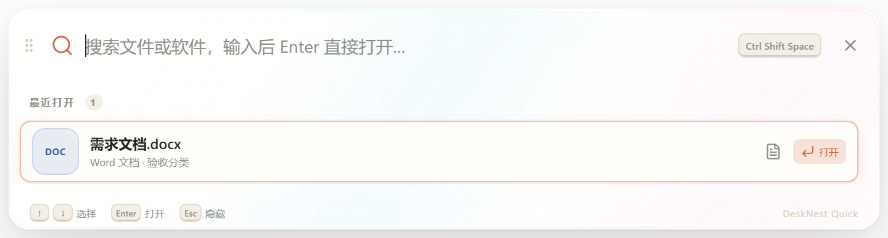
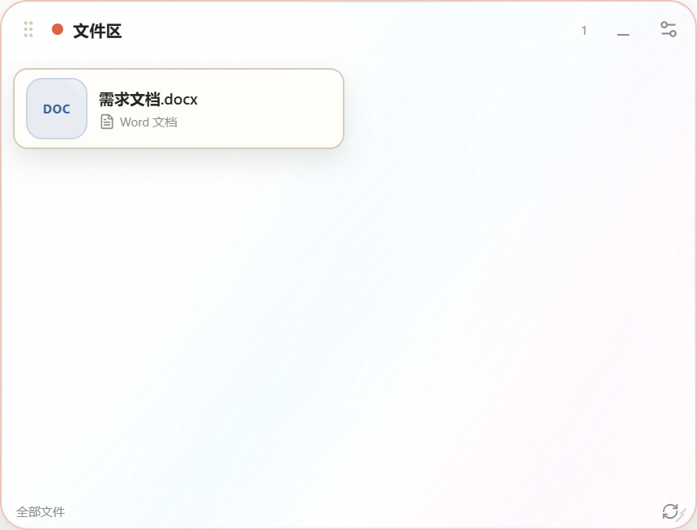
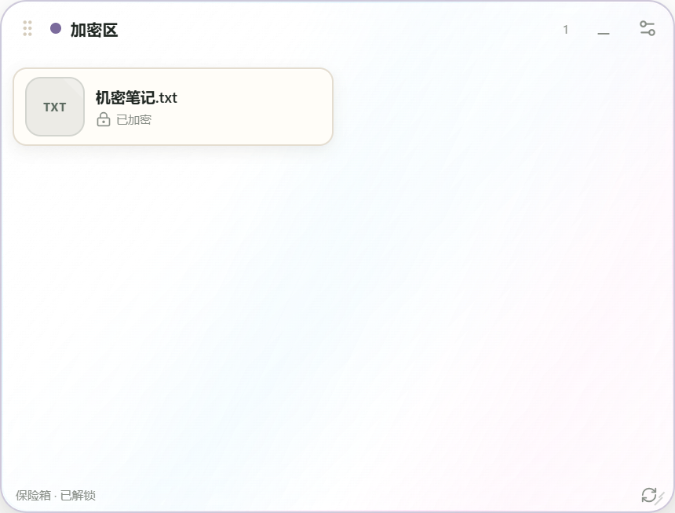
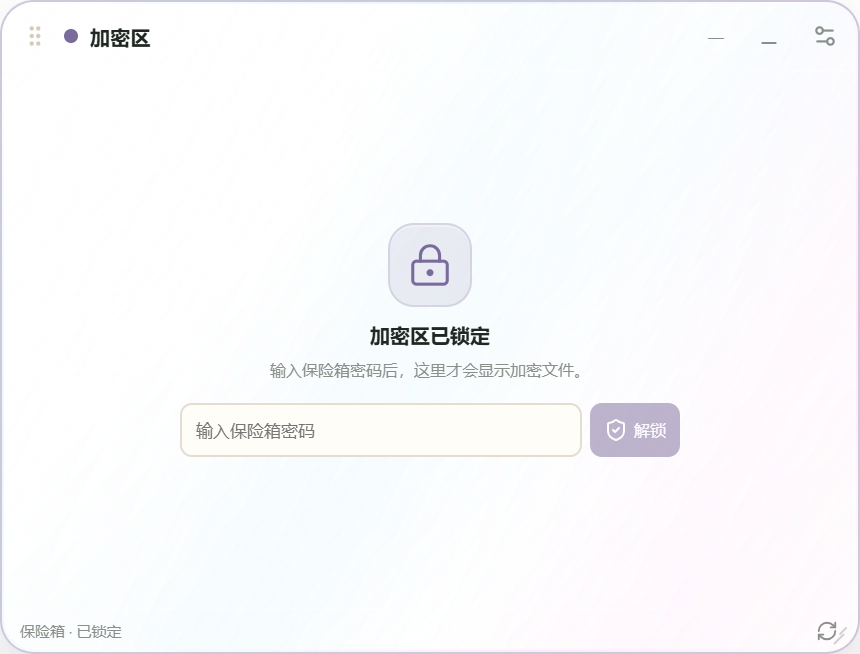

# DeskNest 桌面管家

把散落在桌面的文档、素材和软件快捷方式，收进一个可以模糊搜索、直接打开、按自定义分类整理，并且能完全离线备份的本地资料库。

DeskNest 使用 **Node.js + React + Tauri 2 + Rust** 构建，输出 Windows 与 Linux 原生桌面应用。界面与数据全部在本机，不需要账号，没有遥测，也不会上传文件。



| 水晶浮动搜索 | 透明桌面分区 |
| --- | --- |
|  |  |

## 功能

### 文件保险箱与加密区

- 给文件设置保险箱密码后，可以在详情面板把文件标记为「加密」。标记时**原地加密**，磁盘上只留下 `DSNE1` 分块密文，不再是明文。
- 加密区是默认桌面分区之一。锁屏、重启、手动锁定或从其他窗口锁定后，加密区会清空并显示锁定页；输入密码后才恢复显示加密文件。
- 加密文件在资料库、分区、搜索结果里点击时，都会先要求密码；解锁后才会解密到临时目录并用默认程序打开。
- 文件采用 **AES-256-GCM + 4 MB 独立分块**：每块单独认证、单独压缩，可快速顺序解密；文本类文件用快速 Deflate，已经压缩的媒体/Office/PDF 不会浪费 CPU 做无效压缩。
- 密钥由 **Argon2id** 从密码派生，只在本次会话内存中保留。锁定、锁屏或退出后会清除内存密钥，并清理 `decrypted/` 下的临时明文副本。
- Windows 锁屏通过系统会话状态检测；重新登录后必须再次输入密码。

| 加密区已解锁 | 锁屏/重启后重新锁定 |
| --- | --- |
|  |  |

### 桌面层：浮动搜索 + 透明分区

- **水晶浮动搜索条**：`Ctrl + Shift + Space` 随时唤出，默认在屏幕顶部居中，可拖动并记住位置。搜索文件与软件，方向键选择、`Enter` 直接打开，`Esc` 隐藏。搜索条外壳是透明水晶玻璃，里面的结果卡片保持实心可读。
- **后台常驻**：关闭主窗口只会收进系统托盘，不会退出；分区、桌面搜索胶囊和锁屏监听继续运行。右键托盘可「显示主界面」「显示 / 隐藏桌面模式」或真正退出。
- **桌面搜索胶囊**：开启桌面模式后，屏幕顶部会出现一个更小、更实的搜索胶囊；点击它才展开完整浮动搜索。它和分区一样位于桌面层，不会遮挡普通应用。
- **两者只显示一个**：完整搜索打开时胶囊自动隐藏；关闭/失去焦点后胶囊自动恢复。不会再同时出现两个搜索框。
- **预检索缓存**：启动时构建一次内存索引，搜索窗口只读取缓存并本地过滤，不在每次打开时重新扫描磁盘；文件/分类变更会标记索引失效，下次打开重新构建。
- **分区拖入即保存**：文件拖进「文件区」会复制到统一资料库；文件夹会作为**一个文件夹项目**保存，内部文件一起复制但不拆散；拖进「加密区」会导入后加密（文件夹会递归加密内部文件）。每个分区右上角也提供 `+` 按钮，可以用文件选择器直接添加。
- **桌面透明分区**：`Ctrl + Shift + D` 显示/隐藏。默认提供「程序区」「文件区」「加密区」。
- 分区窗口位于**桌面层**（不置顶，不遮挡其他应用），等价于占用一块桌面图标区域；点击顶部「桌面模式」可一键同时显示/隐藏透明分区与桌面搜索胶囊。
- 每个分区是一个透明水晶小窗，但分区里的文件、软件是**实心卡片**，单击直接打开或启动，不透明、不糊。
- 分区外壳采用**正中心通透、向四周平滑变实**的径向透明度，边缘更清晰；默认尺寸为宽 30%、高 38%，旧版默认布局升级时自动放大。
- 设置 →「桌面工具」→「分区统一透明度」可统一调整三个分区，25%–95% 实时生效并持久化。
- 分区可拖动标题移动、拖动右下角缩放；可以新建、改名、换色、按「全部/软件/文件/加密文件」筛选，或绑定到自定义分类。**任意两个分区的边界不能重叠**，拖到重叠位置会自动退回。
- **布局会自动记住**：分区的位置、大小、是否显示，以及浮动搜索条的位置都会持久化；关闭主窗口时额外保存一次，重启后按原样恢复。
- 资料库与备份目录可在设置中更改；迁移完成后应用会自动重启。
- 把系统文件或快捷方式直接拖进分区，会导入统一资料库；如果分区绑定了分类，会自动归档。
- 分区设置会持久化，重启后恢复位置、大小、筛选与可见状态。

### 文件与软件统一管理

- 拖入 DOCX、PDF、图片、视频、压缩包或整个文件夹，文件会复制到统一资料库，原文件保持不动。
- 拖入 `.lnk`、`.url`、`.exe`（Windows）或 `.desktop`、可执行 `.AppImage`（Linux），自动解析为软件卡片。
- 软件图标会从目标 `EXE` / 快捷方式提取**原生图标**并缓存；取不到时自动退回首字母色块。
- 双击文件用系统默认程序打开，双击软件卡片直接启动；也支持右键菜单、详情面板和桌面分区内单击启动。
- 「从桌面导入快捷方式」可以一次扫描桌面，把已有软件映射进来。
- 收藏、最近打开、网格/列表视图、深浅主题。

### 模糊搜索

- 对文件名、扩展名、启动目标、分类名进行模糊匹配。
- 支持按当前资料库、文件、软件、收藏、最近打开或自定义分类范围搜索。
- `Ctrl/Cmd + K` 聚焦搜索，`Esc` 清空。

### 自定义分类

- 新建、改名、换色、删除分类。
- 一个项目可以属于多个分类。
- 把文件/软件卡片直接拖到左侧分类上即可归档；从桌面拖入时，落在某个分类行上会自动导入并归档。
- 删除分类只移除标记，不删除文件和软件。

### 离线备份与恢复

- 一键生成 ZIP：资料库文件、快捷方式副本、软件映射、分类、收藏、最近打开和设置全部打包。
- 定时备份支持**每小时 / 每天 / 每 7 天**，也可以选择「关闭定时（仅文件变化）」。
- 文件导入、重命名、删除、加密/解密后，约 3–5 秒自动生成一份完整备份；文件夹导入同样只生成一个文件夹单元，但备份包含内部全部文件。
- **立即完整备份**：底部按钮随时手动生成一份完整 ZIP，不受定时策略影响。
- 备份面板会列出**已备份文件**与**未备份文件**，按最近一次备份时间判断，新增或修改过的文件会进入未备份清单。
- 恢复前会自动创建一份「恢复前保护」备份，再替换资料库与映射。
- **主动导出加密包**：把当前完整快照和已有历史备份合并成一个 `.dnb` 文件，设置独立密码；密码不会写入磁盘。
- **还原加密包**：选择 `.dnb` 并输入密码后，整库、软件映射、分类与设置一起恢复；密码错误不会改动任何数据。
- 备份和导出包都只写本地磁盘，不联网、不上传。

## 技术栈

| 层 | 技术 |
| --- | --- |
| 前端 | React 19、TypeScript、Vite 8、Fuse.js、Lucide |
| 桌面壳 | Tauri 2 |
| 后端 | Rust、Serde、WalkDir、Zip、Trash、Open |
| 打包 | Windows NSIS；Linux `.deb` + `.AppImage` |

## 快速开始

要求：

- Node.js **>= 22.12**（开发与验证使用 Node 24.18.0）
- Rust stable 与 Cargo
- Windows：WebView2 Runtime + Tauri 的 [Windows 构建依赖](https://v2.tauri.app/start/prerequisites/)
- Linux：`libwebkit2gtk-4.1-dev`、`libayatana-appindicator3-dev`、`librsvg2-dev`、`patchelf` 等

```bash
npm install
npm run check      # TypeScript 类型检查
npm run desktop    # 启动 Tauri 开发窗口
```

仅预览前端界面（使用演示数据，不读写本机文件）：

```bash
npm run dev
```

## 构建安装包

### Windows

```bash
npm run bundle:win
```

输出：

- `artifacts/DeskNest_1.0.0_x64-setup.exe`（NSIS 安装包）
- `artifacts/DeskNest-win-x64-portable.zip`（便携版，解压后运行）

> Tauri 的 `windres` 在包含空格的构建路径下存在参数拆分问题。`scripts/build-win.ps1` 会在检测到项目路径含空格时，自动创建无空格的 junction 作为 `CARGO_TARGET_DIR`，因此项目可以放在 `Desktop\desktop manager` 这类路径下构建。

### Linux

在 Ubuntu 24.04 / 对应发行版安装依赖后：

```bash
sudo apt install libwebkit2gtk-4.1-dev libayatana-appindicator3-dev \
  librsvg2-dev libgtk-3-dev libxdo-dev libssl-dev patchelf build-essential
npm run bundle:linux
```

输出：

- `src-tauri/target/release/bundle/deb/*.deb`
- `src-tauri/target/release/bundle/appimage/*.AppImage`

### 双平台 CI

仓库内置 [`.github/workflows/build.yml`](.github/workflows/build.yml)，在 GitHub Actions 上同时构建 Windows NSIS 和 Linux `.deb` / `.AppImage`，并上传构建产物。

## 数据目录

Tauri 使用应用标识 `com.desknest.manager` 作为数据目录：

- Windows：`%APPDATA%\com.desknest.manager`
- Linux：`~/.local/share/com.desknest.manager`

目录结构：

```text
com.desknest.manager/
├─ library/             # 统一资料库，导入的文件与文件夹
├─ shortcuts/           # 托管的快捷方式副本
├─ icons/               # 从 EXE / 快捷方式提取的原生软件图标缓存
├─ backups/             # 本地 ZIP 备份与恢复前保护包
├─ decrypted/           # 仅查看时释放的临时明文，锁定/启动时清空
├─ webview2/            # WebView2 缓存与运行数据（不进入备份）
└─ state.json           # 分类、软件映射、收藏、最近打开、备份设置、加密索引
```

在应用内可以通过「设置 → 资料与备份」直接打开这些目录。

如果需要便携式数据目录，可以在启动应用前设置 `DESKNEST_DATA_DIR` 环境变量，资料库、备份和 WebView2 缓存会一起放到该目录：

```powershell
$env:DESKNEST_DATA_DIR = "D:\DeskNestData"
.\DeskNest.exe
```

## 使用说明

1. 把 DOCX、PDF、图片或文件夹拖进窗口，松手后复制进 `library/`。
2. 把桌面快捷方式拖进来，软件会出现在「软件库」；快捷方式本身会复制到 `shortcuts/`，原快捷方式可继续保留。
3. 左侧「+」新建分类；把卡片拖到分类行，或打开详情面板勾选多个分类。
4. 在顶部搜索框输入名称、格式或分类关键词。
5. 点击左下角「离线备份」管理备份、自动备份和恢复。
6. 点击顶部锁按钮设置保险箱密码；打开文件详情，点「加密此文件」。
7. 点击左下角「快速搜索条」打开水晶浮动搜索；点击「桌面分区」编辑分区并显示到桌面。
8. 「加密区」在锁屏或重启后会锁定；输入密码后才会显示加密文件，单击直接打开。

### 桌面快捷键

| 快捷键 | 作用 |
| --- | --- |
| `Ctrl + Shift + Space` | 显示/隐藏水晶浮动搜索条 |
| `Ctrl + Shift + D` | 显示/隐藏桌面透明分区 |
| `Ctrl + Shift + M` | 从后台唤回 DeskNest 主界面 |
| `↑` `↓` | 搜索条内选择结果 |
| `Enter` | 打开当前结果 |
| `Esc` | 隐藏搜索条 |

> 搜索条默认在屏幕顶部居中；分区位于桌面层。关闭主窗口会隐藏到系统托盘，应用继续后台运行，只有托盘菜单「退出 DeskNest」才会真正结束进程。

### 快捷方式解析

- Windows `.lnk`：通过系统 `WScript.Shell` 读取目标、参数与工作目录；启动时直接运行托管副本，参数和 UWP 快捷方式由系统处理。
- Windows `.url`：读取 URL，用默认浏览器打开。
- Windows `.exe`：直接登记启动目标，不复制可执行文件。
- Linux `.desktop`：读取 `Name`、`Exec`、`Path`，优先使用 `gio launch`，失败时回退到解析出的命令。
- Linux `.AppImage`：仅当文件可执行时登记为应用。

## 目录结构

```text
.
├─ src/                    # React 界面
│  ├─ components/          # 卡片、详情、分类、备份、设置、快速搜索、桌面分区
│  ├─ lib/                 # Tauri API 封装、模糊搜索、格式化
│  └─ App.tsx
├─ src-tauri/
│  ├─ src/commands.rs      # Tauri IPC 命令
│  ├─ src/desktop.rs       # 快速搜索窗 / 透明分区多窗口管理
│  ├─ src/vault.rs         # 密码派生、分块 AES-GCM、压缩/解密
│  ├─ src/importer.rs      # 文件复制、快捷方式解析
│  ├─ src/library.rs       # 资料库扫描与项目模型
│  ├─ src/backup.rs        # ZIP 备份、校验与恢复
│  ├─ src/launcher.rs      # 文件/软件启动与定位
│  └─ tauri.conf.json
├─ scripts/build-win.ps1   # Windows 含空格路径的构建修复
├─ .github/workflows/build.yml
└─ docs/                   # 界面截图
```

## 设计与安全

- 所有文件操作都限制在应用数据目录内；IPC 传入的相对路径会拒绝 `..`、绝对路径和非法组件。
- 恢复 ZIP 时使用 `enclosed_name()` 防目录穿越，并拒绝未知顶层条目；恢复前先备份当前数据。
- **加密文件是真正落盘加密**：文件内容被 `DSNE1` 分块密文替换，不是 UI 隐藏。
- 加密只保护当前资料库文件；**加密前生成的旧 ZIP 备份、系统回收站、卷影副本或其他软件缓存可能仍含明文**。加密后建议重新做一次备份并清理旧备份。
- 查看加密文件会短暂释放到 `decrypted/` 临时目录（外部默认程序需要文件路径）。锁定、锁屏、退出或 15 分钟后会清理；不要把该目录当作安全存储。
- 密码只存在于内存，**忘记密码无法恢复**；密码至少 6 个字符，建议使用更长的随机密码。
- 加密区锁定时不会把加密文件名渲染到 DOM，只显示锁定页。
- 删除文件进入系统回收站；移除软件映射只删除托管快捷方式，不卸载原软件。
- 应用不需要网络权限；前端 CSP 仅允许本地资源、IPC 与开发服务器。

## 已知边界

- 软件卡片使用字母/缩写图标，不提取原始 `.exe` / `.desktop` 图标，避免依赖平台图标接口。
- Linux 终端类 `.desktop` 在无法通过 `gio launch` 启动时，可能不会自动打开终端窗口。
- 拖入文件夹会递归复制，超大目录没有逐文件进度条；界面会显示导入状态。
- 恢复是整库替换，不支持只恢复单个文件；需要单文件时可以直接打开备份 ZIP 取用。
- Linux 安装包由 CI 产出；本地 Windows 环境只验证 Windows 安装包。
- 文件保险箱密码当前不支持在线修改；重建保险箱需要先解除所有文件加密，再重新设置。密码丢失不可恢复。
- 加密文件的原文件名、大小与分类元数据仍以明文保存在索引中；锁定的加密区不会显示它们，但主资料库列表仍会显示文件名。
- 加密后旧备份可能包含加密前的明文副本，详见「设计与安全」。
- 桌面分区在桌面层（底部窗口），不会覆盖普通应用；不使用时可 `Ctrl + Shift + D` 隐藏。多显示器时重启后会先回到主显示器上的保存坐标。
- 关闭主窗口不会退出，而是留在系统托盘后台运行；需要从托盘菜单「退出 DeskNest」结束进程。
- 桌面模式一键开启会同时显示透明分区与桌面搜索胶囊；分区位于桌面图标层，可能和桌面图标占用同一块区域。点击胶囊才会展开完整浮动搜索。
- 分区与搜索条依赖系统全局快捷键；如果快捷键被其他软件占用，仍可从主界面按钮打开。
- 水晶透明效果依赖系统合成器（Windows WebView2 透明窗口 / Linux 桌面合成器）。

## 验证命令

```bash
npm run check
npm run build
cd src-tauri
cargo check
```

本轮交付已通过：

- TypeScript 类型检查与 Vite 生产构建。
- Windows Tauri release 编译与 NSIS 安装包生成。
- 在真实 Tauri WebView2 窗口中通过 IPC 调用完成：DOCX 导入、统一目录复制、创建分类、归档、ZIP 备份、重命名、恢复、UI 刷新、模糊搜索和详情面板展示。
- 在真实多窗口环境中验证：水晶浮动搜索窗、程序区/文件区透明分区、分区内文件卡片可见、窗口尺寸与位置持久化。
- 文件保险箱全链路验证：密码设置、锁定状态、`DSNE1` 密文落盘、错误密码拒绝、解锁后临时解密打开、锁定清理临时文件、加密区锁定不泄露文件名、解锁后显示并点击打开。
- Windows 便携版启动（通过 `DESKNEST_DATA_DIR` 指定隔离测试数据目录）。
- 关闭主窗口后进程继续后台运行，主窗口隐藏；`Ctrl + Shift + M` 可正常唤回。
- 软件原生图标全链路验证：导入 `notepad.exe` 后生成 64×64 PNG 原生图标并随项目返回。
- 搜索条默认位置验证为屏幕顶部居中（1920×1080 下约 `408,24`）。
- 桌面模式验证：分区显示时顶部出现 `430×58` 桌面搜索胶囊；点击可展开完整搜索。
- 分区重叠验证：移动到另一分区范围后，后端 450ms 监听自动退回原位置，状态文件保持不变。
- 资料库迁移验证：修改目录后复制现有文件、更新 `state.json` 并自动重启。
- 备份验证：已备份/未备份清单、ZIP 备份、`.dnb` 加密导出包、错误密码拒绝、密码正确后整库还原。
- 定时备份实现为每 60 秒检查一次到期时间；提供每小时、每天、每 7 天和仅手动四种策略。
- 搜索性能验证：1500 个文件时缓存后的 `bootstrap` 约 30ms；桌面胶囊点击后胶囊隐藏、完整搜索显示，关闭后胶囊恢复。
- 分区层级验证：分区位于 Explorer 桌面图标宿主之上、普通应用之下，`WindowFromPoint` 命中 WebView 内容，可接收点击和文件拖放。
- 文件变化备份验证：导入新文件后约 3–5 秒自动出现 `auto` 类型备份，未备份清单归零。
- 文件夹导入验证：导入含两个文件的文件夹后只生成一个 `folder` 项目，内部文件完整复制；约 3–5 秒后生成 auto 备份。

手工验收建议：

- 拖入 DOCX → 出现在文件库，原文件仍在桌面，资料库有副本。
- 拖入 `.lnk` / `.desktop` → 出现软件卡片，双击能启动。
- 新建分类 → 把卡片拖到分类 → 分类计数变化。
- 搜索文件名、扩展名、分类名 → 均可命中。
- 创建备份 → 删除/重命名项目 → 恢复备份 → 数据与映射回滚。
- 重启应用 → 分类、收藏、软件映射保持。
